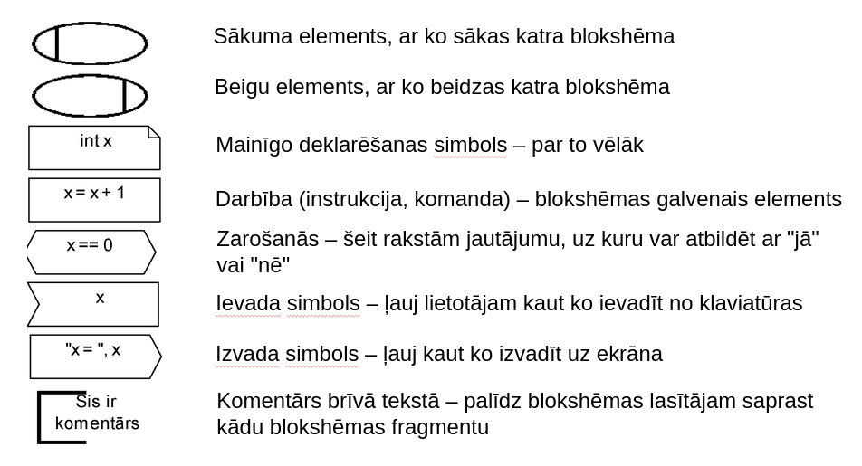
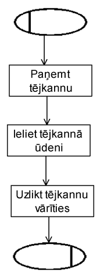
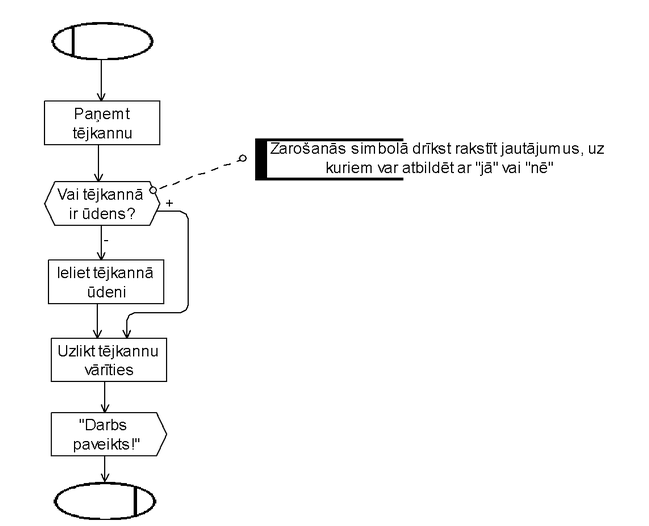
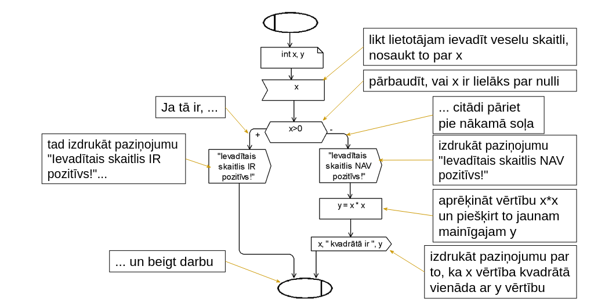

# Rencis
## INFO
### **15 praktiskie darbi**
- teorijas atkartosana/apguve
- uzddevumu risinājumu piemēri
- patstāvīga uzdevuma risināšana
- uzdevumu risināšana "pie tafeles"

te bus uz papira

### **2 kontoldarbi**
- KD1 8-9 oktobris
- KD2 19-20 novembris

### Info par KD
- 90 min
- viena A4 lapa
- nevar datorus izmantot
- pie tāfeles dod punktus

**viss info ir [estudijas](https://estudijas.lu.lv/)**

## Algoritms un blokshēmas

Programmēšana - instrukciju sastādīšana datoram saprotamā valodā noteikta uzdevuma veikšanai
- bassicly algoritms

### veidi

Algoritmu var uzdot (pierakstīt dažādos veidos)
1. dabīgā valodā
- iztāstam pa soļiem. kas jādara - visprims darām to, pēc tam to utt.
2. grafisku diagrammu veidā
- iepriekš norunārtā vienošanās par katra grafiskā simbola nozīmi
3. Programmēšanas valodā
- stingri noteiktas ko mandas ar iepriekš zināmu nozīmi
- tāpat kā dabīgās valodas, arī programmēšanas valodas ir dažāds - tajāsir dažādas komandas (apskatīsies python un c++)

### grafiskā (blokshēmu) / darbības


### veidošana
#### uzd. uzvārīt tēju
##### valoda
1. paņemt tējkaņu
2. ielikt  tējkannā ūdeni 200 ml
3. uzlikt tējkannu vārīties

##### blokshēma


bet te problēmas, piem:
- ja ūdens jau ir

##### part 2 labots
1. paņemt tējkannu
2. ja tējkannā nav ūdens, tad ieliet tējkannā ūdeni, citādi šajā solī nedarīt neko
3. uzlikt tējkannu vārīties

**Visus blakus apstākļus nekad nevarēs ņemt vērā, bet jācenšas ņemt vērā būtiskākos** 
- var nebūt pašas tējkannas
- var būt atslēgta ūdens padeve
- var nebūt, kur likt ūdeni vārīties



### Mainīgie
**Mainīgie** - jau no matemātikas pazīstamss jēdziens
1. to indentificē tā vārds
2. mainīgais var pieņemt dažādas vērtībaaas
- mainīgā vērtību var ievadīt lietotājs
- mainīgajam vērtību var piešķirt kādā no algoritma darbībām
- citu veidu, kā mainīgais var iegūt jaunu vērtību, nav!
3. katrs mainīgais pirms lietošanas ir **jādeklarē**
- deklarēt – norādīt, kāda veida vērtības mainīgais drīkstēs pieņemt (norādīt mainīgā tipu): int, string, char, bool, double.
4. Divas svarīgas lietas par mainīgajiem
- pirms izmantošanas mainīgais ir jādeklarē
- pirms mainīgā vērtības lietošanas mainīgajam ir jābūt piešķirtai vērtībai (vienā no diviem iespējamajiem veidiem)

Mainīgie blokshēmās
1. Mainīgo deklarācijas simbols
- mainīgo var deklarēt (int x, double y)
2. Ievada simbols
- mainīgā vērtību var likt ievadīt lietotājam no klaviatūras (x)
3. Darbības simbols
- mainīgajam var piešķirt vērtību (x = 17)
- mainīgā vērtību var piešķirt citam (vai tam pašam mainīgajam) (y = x y = x+5 x = x+1)
4. Izvades simbols
- mainīgā vērtību var izvadīt uz ekrāna (x "x = ", x x+5)
5. Zarošanās simbols
- par mainīgā vērtību var uzdot jautājumu, uz kuru var atbildēt ar "jā" vai "nē" (x == 0 x > 17 x + 5 <= y * 3)

### Sakarīgas blokshēmas
Uzdevums
- Lietotājs ievada veselu skaitli. Noskaidrot, vai ievadītais skaitlis ir pozitīvs vai nav. Ja tas nav pozitīvs, aprēķināt un izvadīt arī šī skaitļa kvadrātu.

Par formulējumu...
- ja teikts "noskaidrot", "aprēķināt" u. tml., tas nozīmē, ka atbilde uz šo jautājumu jāpaziņo lietotājam (tas ir, jāizdrukā uz ekrāna)

Grūtākā lieta – izdomāt algoritmu dabīgā valodā
- likt lietotājam ievadīt veselu skaitli, nosaukt to par x
- pārbaudīt, vai x ir lielāks par nulli (ja tā ir, tad izdrukāt paziņojumu "Ievadītais skaitlis IR pozitīvs!" un beigt darbu, citādi pāriet pie nākamā soļa)
- izdrukāt paziņojumu "Ievadītais skaitlis NAV pozitīvs!"
- aprēķināt vērtību x*x un piešķirt to jaunam mainīgajam y
- izdrukāt paziņojumu par to, ka x vērtība kvadrātā vienāda ar y vērtību

Atlicis vieglākais – pārtulkot šo algoritmu blokshēmu valodā



### Uzdevums1
Lietotājs ievada 3 veselus skaitļus. Noskaidrot, vai eksistē trijsturis ar šadiem malu garumiem.
```
ievada int x, y, z
bool x1, y1, z1

Veic darbību x <= y + z
- true x1 = true
- false x1 = false

Veic darbību y <= x + z
- true y1 = true
- false y1 = false

Veic darbību z <= y + z
- true z1 = true
- false z1 = false

pārbauda x1 = true | y1 = true | z1 = true
- true var izveidot
- false nevar izveidot
beigas japartaisa
```
(uztaisit ka blokshemu velak)

### Uzdevums 2
Lietotājs ievada 3 veselus skaitļus a, b, c. aprēķinātun izvadīt izteiksmju x=-b/(2<sup>a</sup>) un y=ax<sup>a</sup>+bx+c
``` 
idk man man galags
galvenais double izmantot nevis int
```

### Cikli
Atkārtojas viens un tas pats vairākas reizes

## 2. stunda
kinda stāsta basic shit par c++ un python
``` cpp
cout << "izvade";
cin >> ievade;
```

## 3. stunda
### pirms tam 2. stunda uzd
```cpp
a=b=c=49
```
izpildas c=49 => c=b => b=a

``` cpp
mult*=x++

mult = mult * x
x = x + 1
//1. mult = mult * x
//2. x=x+1
```
### Aritmētiskie operātori
#### +
Saskaita
#### -
Atņem
#### *
Reizina
#### /
Dala
#### %
Atlikums
``` cpp
cout << 9 % 2;
//izprintē 1
```
### Salīdzināšana
<, >, ==, !=, <=, >=

izvada true or false

### uzd
```cpp
#include <iostream>
using namespace std;

int main(){
    int x, y;
    cout << "Ievadi a ==>";
    cin >> a;
    cout << "ievadi b ==>";
    cin >> b;
    
    cout << (double) a/b
}
```

### Loģiskie
#### binārie
- && loģiskais AND
- || loģiskais OR
#### unārie
- ! loģiskais  NOT 

<!-- ielikt bildi ar tabulu -->

```cpp
#include <iostream>
using namespace std;

int main(){
    cin << x;
    cin << y;
    sum =x+y;
    if((x+y)%2){
        cout >>  "para";
    }
    else {
        cout >> "nepara";
    }
}
```
### Konvertacija
c++
```cpp
y = (double) x
```

python
```py
y = int(x)
```

## 4. stunda
### Cikli
#### Ar skaitītāju
##### C++
for (<1>; <2>; <3>){ \
    <4> \
}

1. sākuma stāvokklis
2. cikla nosacījums
3. cikla solis 

jebkurš var bīt tukšs

```cpp
// izdruka no 0-9
for (int i=0; i<10; i++){
    cout << i;
    cout << endl;
}
```

##### python
for < var > in range (< from >, < to > *< step >*):\
    < commands >
    
< var > - cikla mainīgais \
< from > - sākuma vērtība \
< to > - beigu vērtība (ja grib 5 jāliek 6) \
*< step >* - opcionāls

#### Ar priekšnosacījumu *while*
##### C++
```cpp
while (loģiskā izteiksme){
    ...
}
```
Sākuma vērtības jāpieškir pirms cikla

###### Piemērs
izprintēt no 0 līdz 9
```cpp
int i = 0;
while (i<10){
    cout << i << endl;
    i++;
}
```

##### python
```py
while <loģiska izteiksme>:
  ...
```
###### piemers
```py
x=0
while x<10:
    print(x)
    x+=1
```

#### Ar pēcnosacījumu
##### C++
``` cpp
do {
    ...
} while (<loģiskā izteiksme>)
```

###### piemers
```cpp
int i=0;
do {
    cout << i << endl;
    i++;
} while (i<10);
```
##### python
NAV

#### break and continue

1. break
- nodod vadību laukā no cikla nākamajai komandai
2. continue
- nodod vadību nākamajai cikla iterācijai (for cikla gadījumā izpildot arī pēc-iterācijas darbību (-as))
3. goto
- nodod vadību citai patvaļīgai komandai (nav ieteicams izmantot, jo padara kodu nelasāmu)

#### uzd

```cpp
cin >> x;
bool isPrime = true;

if (x<=1){
    cout << "nav";
}

for (int i = 2; i = n/2; i++){
    if(n%i==0){
        cout << "nav";
        isPrime = false;
        break;      
    }
}

if (isPrime){
    cout << "ir";
}
```

### Funkcijas

### 5. stunda
#### Masīvi(c++) un sarkasti(python)

##### c++ masīvi
Masīvs ir konstrukcija, kas ļauj vienotā struktūrā saglabāt vairākas viena datu tipa vērtības (elementus)

Veselu skaitļu masīva deklarēšana
1. int x[5];
    - mainīgajā x varēs saglabāt 5 veselus skaitļus
2. int x[5]={17, -5, 0, 2, 2};
    - deklarācijas brīdī drīkst piešķirt sākuma vērtības
3. int x[5]={17, -5};
    - drīkst piešķirt sākuma vērtības arī tikai dažiem pirmajiem masīva elementiem (pārējie paliek neinicializēti)

Piekļuve masīva elementam
- piekļuve notiek, norādot elementa kārtas numuru (indeksu) masīvā
    - n elementu masīvam indeksi tiek numurēti no 0 līdz n-1
- x[3] masīva x elements ar indeksu 3 (jeb pēc kārtas 4. elements)
    - x[3] = 17;
    - cin >> x[2];
    - cout << x[4];
    - int i=x[0];

Masīvs uzskatāms tikai par elementu kopumu, tāpēc nekādas darbības ar pašu masīvu veikt nevar
```cpp
int m[5]={1,2,3,4,5}, n[5];
n=m; //Šādi darīt nevar!
if (n==m) ... //Šādi darīt nevar!
```

Masīva elementus iespējams apstrādāt vienotā veidā
- veido ciklu, katrā iterācijā apstrādājot vienu masīva elementu
- par elementa indeksu kalpo cikla skaitītājs

```cpp
int x[5];
for (int i=0; i<5; i++)
  cin >> x[i];
```

##### Python saraksti

Saraksts ir konstrukcija, kas ļauj vienotā struktūrā saglabāt vairākas vērtības (elementus)
- vērtības var būt dažādu tipu

Saraksta izveidošana
- arr = []
    - mainīgajā arr ir tukšs saraksts
- arr = [17, -5, 0, "abc", 2.5]

Piekļuve saraksta elementiem
- piekļuve notiek, norādot elementa kārtas numuru (indeksu) sarakstā
    - n elementu sarakstam indeksi tiek numurēti no 0 līdz n-1
- saraksta aktuālo garumu iespējams noskaidrot ar funkciju len
```py
arr = [17, -5, 0, "abc", 2.5]
l=len(arr)
print(l) # 5
```
- darbošanās ar saraksta indeksiem tiek pārbaudīta
```py
x = [17, -5, 0]
x[5] = "def"
#IndexError: list assignment index out of range
```
- elementa pievienošana un dzēšana
```py
arr.append(17)
arr.pop()
```

#### Masīvu dimensijas
C++ ir n-dimensiju masīvi iespējamaji


### 6. stunda
#### char datu tips
Simboli ir sakārtoti simbolu tabulā

Piemēram:
- ASCII
- EBCDIC
- HTML codes
- ...

Jebkurā tabulā vienkopus pēc kārtas atrodas:
- latīņu alfabēta
    - mazie burti
    - lielie burti
- cipari

#### char un int saistiba
```cpp
char c = "a";
int i = c;
cout << i; //izvada 97
```
```cpp
int i = 52;
char c = i;
cout << c; //izvada '4'
```

```cpp
//Salīdzināšanas operacijas
char c;
cin >> c;
if (c>='A' && c<='Z'){
    cout << "Ir lielais burts\n";
}
```

```cpp
//Aritmētiskās operacijas
char c;
cin >> c;
int i = c - '0';
```

#### Simbolu virkne
Zema - char masīvs
Augsta - string main;igais

Simbolu virkne ir masīvi

##### Zema
Jābeidzas ar \0

### 7. Stunda
##### Dinamiskās datu struktūras
##### Kas ir dinamiska datu struktūra
Dinamisks - kompilācijas laikā nav izdalīta atmiņa, bet pēc vajadzības var izdalīt izpildes laikā

Dinamiska datu struktūra - struktūra kurā tiek glabāta dinamiskajā atmiņā un kurai var piekļūt caur statiskajai atmiņā esošu norādi

Dinamisku datu struktūru veidošanas motivācija – statiskās atmiņas taupīšana (pati norāde aizņem maz vietas)

##### Norāde (pointer)
Norāde
- < typeName > * < variableName >
  - int * x 
  - char * s
- pati norāde (neatkarīgi no datu tipa, uz kura mainīgo tā norāda) aizņem 4 baitus statiskajā atmiņā
- norāde ir vesels skaitlis (norādītās informācijas atmiņas adrese) heksadecimālajā pierakstā
```cpp
int * x = new int;
cout << x; // 0x3d3cb8
int * x = new int;
int y = (int)x;
cout << y; // 4013240
```
- norādes izmantošana
```cpp
int * x = NULL; //NULL adrese nozīmē, ka x nenorāda nekur
x = new int; //izveidot vietu skaitlim dinamiskajā atmiņā un likt x norādīt uz šo vietu
*x = 17; //Vietā, uz kuru norāda x, ierakstīt 17
cout << *x; //Izdrukāt to, kas atrodas vietā, uz kuru norāda x
delete x; //Atbrīvo t atmiņas vietu (viena skaitļa garumā), uz kuru norāda x

```

##### Adrese 
Adrese
- vesels skaitlis pieļaujamā atmiņas adresācijas intervālā
- parasti pierakstīts heksadecimālajā pierakstā
- jebkuram mainīgajam var noskaidrot tā adresi, izmantojot adreses ņemšanas operatoru &
```cpp
int x;
int y = (int)&x;
cout << &x << " " << y; //0x22ff74 2293620
```
- adresi kā vērtību var piešķirt norādei
```cpp
int x;
int * y;
y = &x;
cout << y; //0x22ff74
```
```cpp
int x = 5, * y = &x;
*y = 17;
cout << x; // 17
```

##### Refrence
- iespēja piekļūt vienam un tam pašam atmiņas apgabalam ar dažādiem mainīgajiem
- jēdziens pazīstams no funkcijām – parametru var nodot kā vērtību vai kā referenci
- izmantošana
```cpp
int x = 5;
int & y = x; // Deklarējot referenci, jānorāda tās atrašanās vieta atmiņā
cout << x << y; // 55
y = 7;
cout << x << y; // 77
```

### 8. stunda
#### Statiski un dinamiski masīvi
- Statiski masīvi
    - viss masīvs atrpdas statiskajā atmiņā
    - masīva elemntu skaits jāzina jau programmas kompilācijas (rakstīšanas) brīdī
    - visi demonstrētie masīvi bija statiski
- Dinamiski masīvi
    - viss masīvs atrodas dinamiskajā atmiņā
    - statiskajā atmiņā atrodas norāde uz masīva sākumu
    - masīva elementu skaits kompilācijas brīdī var nebūt zināms

#### Darbs ar dinnamisku masīvu C++
- Statiskajā atmiņā jāizveido mainīgais (norāde), kas norādīs uz dinamisko masīvu
    - ```int * mas; <- mas – norāde uz int tipa masīvu```
- Dinamiskajā atmiņā jāizveido masīvs un jāuzliek iepriekš izveidotā norāde uz to
    - ```mas = new int[5];```
- Darbs ar masīvu identisks kā statiska masīva gadījumā
    - ```mas[3]=17;```
- Darba beigās masīvs no dinamiskās atmiņas jāizdzēš
    - ```delete [] mas;```

##### Piemērs
Lietotājs ievada veselu pozitīvu skaitli n. Ļaut lietotājam ievadīt n veselus skaitļus un pēc tam izdrukāt tos pretējā secībā

```cpp
#include <iostream>
using namespace std;

int main() {
  int * m, n;
  cin >> n;
  m = new int[n];
  for (int i=0;i<n;i++) cin >> m[i];
  for (int i=n-1;i>=0;i--) cout << m[i] << endl;
  delete [] m;
  return 0;
}
```
#### Ko īsti zinam par masīviem C++?
- Visi masīva elementi atmiņā atrodas viens aiz otra
- Masīvu identificē tā vārds
    - patiesībā – vārds ir mainīgais, kas norāda uz masīva sākuma elementu
- Masīvam ir noteikts garums
    - tas tiek noteikts masīva izveidošanas brīdī un pēc tam nav maināms

#### Kā C++ funkcijai nodot masīvu caur parametru?
- Nav jēgas nodot visus elementus
- Jānodod pēc iespējas mazāk informācijas, no kuras var iegūt pilnu informāciju par masīvu
    - norāde uz pirmo elementu
        - pārējiem elementiem var piekļūt, ejot uz priekšu pa atmiņas šūnām
    - masīva garums
        - lai zinātu, kur apstāties, ejot uz priekšu pa masīva šūnām no pirmā elementa
        - ja masīvs ir simbolu virkne, garumu nodot nav nepieciešams!

#### Piemērs masīva nodošanai caur parametru C++
- Maksimālā elementa atrašana veselu skaitļu masīvā
```cpp
int getMax(int * mas, int n) {
 int maxNum=mas[0];
 for (int i=1; i<n; i++)
  if (mas[i]>maxNum) maxNum=mas[i];
 return maxNum;
}
```
- Simbolu virknes garuma noteikšanas funkcija
```cpp
int len(char * s) {
 int i=0;
 while (s[i]!='\0') i++;
 return i;
}
```
32 A->a
